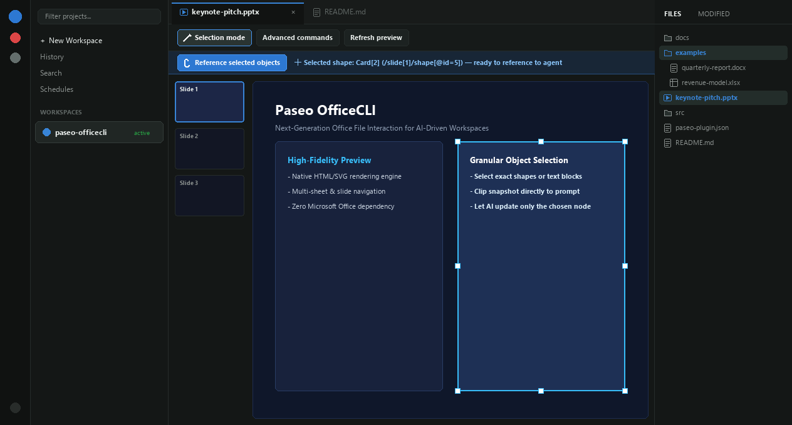
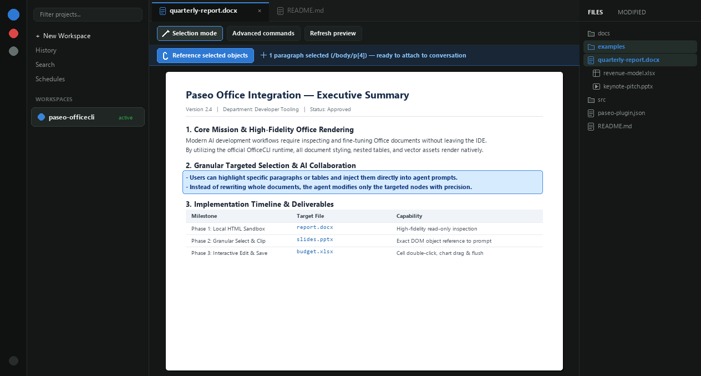
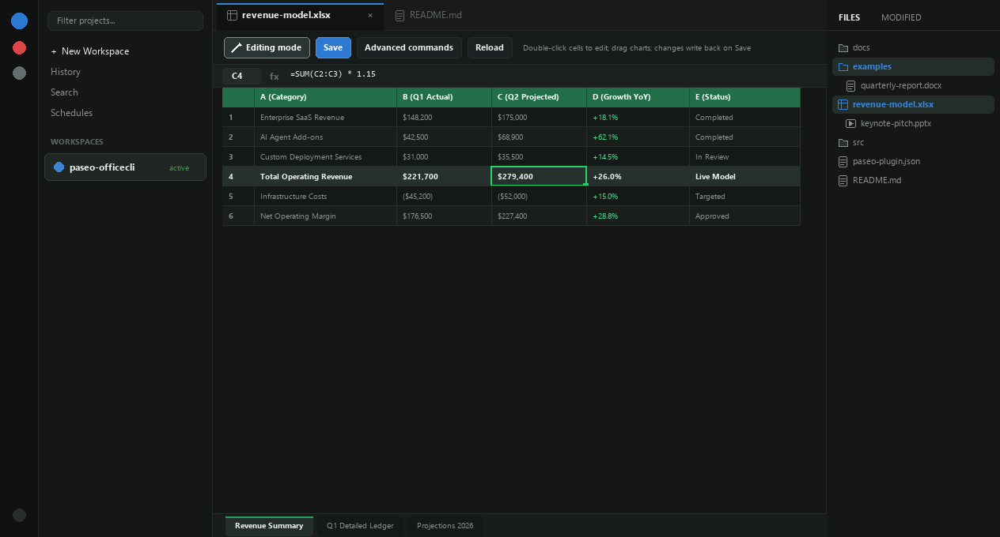

# Paseo OfficeCLI

Preview, selectively reference, and edit Office files directly within [Paseo](https://github.com/getpaseo/paseo) — powered by the official [OfficeCLI](https://github.com/iOfficeAI/OfficeCLI). No Microsoft Office installation required.

[English](README.md) · [简体中文](README.zh-CN.md)

[](https://github.com/plumegod/paseo-officecli/actions/workflows/check.yml)
[](LICENSE)

[Features](#features) · [Installation](#installation) · [Usage](#usage) · [Safety](#safety) · [Development](#development)



> **Problem solved**:
> AI assistants struggle to inspect or modify binary Office documents without clumsy format conversions or rewriting 50-page files.
> Combining [Paseo](https://github.com/getpaseo/paseo) with [OfficeCLI](https://github.com/iOfficeAI/OfficeCLI) allows you to view files, reference specific highlighted regions to AI, and edit spreadsheets directly inside your workspace.

---

<a id="features"></a>
## Features

| Feature | Description | Formats |
| :--- | :--- | :---: |
| **Fast Preview** | Open documents directly in the file panel without launching heavy desktop Office suites. Auto-refreshes when files change on disk. | `.docx` `.xlsx` `.pptx` |
| **Granular Selection & Editing** | Highlight specific paragraphs, tables, or shapes and attach the exact node to your conversation so AI can modify that section instead of rewriting the entire document. | `.docx` `.pptx` |
| **In-Place Excel Editing** | Double-click cells to update values or formulas, drag charts to adjust layout, and save modifications directly back to the original workbook. | `.xlsx` |
| **CLI Console** | Pass JSON argument arrays directly to official OfficeCLI commands to inspect or update document structures, with live output and stop controls. | `.docx` `.xlsx` `.pptx` |

|  |  |
| :---: | :---: |

> Word and PowerPoint interactive modes provide preview and object selection, **not in-place text typing**. Use advanced commands, a Paseo agent, or external tools for typing edits.

---

<a id="requirements"></a>
## Requirements

| Component | Minimum Requirement | Notes |
| :--- | :--- | :--- |
| **Paseo** | **0.16.0-beta.1 or newer** | Plugins enabled; Node.js with npm available on the daemon host for package acquisition |
| **OfficeCLI** | **1.0.160 or newer** | Official stable binary on daemon machine |
| **Client** | Desktop or modern browser | Native mobile preview is not supported |

---

<a id="installation"></a>
## Installation

1. Verify that official OfficeCLI is installed on the machine running your Paseo daemon (see [official OfficeCLI installation guide](https://github.com/iOfficeAI/OfficeCLI#installation)):

   ```sh
   officecli --version
   ```

2. Enable plugins in **Paseo Settings → Plugins**. Paste `npm:paseo-officecli` into **Plugin source** and select **Install plugin**. Alternatively, run one install command on the daemon host:

   ```sh
   paseo plugin add npm:paseo-officecli
   ```

   This uses Paseo's official [npm plugin source](https://paseo.sh/docs/plugins/reference#npm-installation-and-publishing). Paseo downloads the published package, compiles it and manages its lifecycle; no source checkout, manual dependency installation or separate build is required.

3. Confirm the plugin reports `running`:

   ```sh
   paseo plugin ls
   ```

   If installation fails, inspect `paseo plugin logs paseo-officecli`.

Open any `.docx`, `.xlsx`, or `.pptx` file in the workspace tree, select **OfficeCLI**, and start working.

To update the plugin:

```sh
paseo plugin update paseo-officecli
```

For custom paths or upgrade details, see [discovery and upgrade details](docs/USAGE.md#officecli).

---

<a id="usage"></a>
## Usage

### Document modes & interactive workflow

| Format | Mode | Action |
| :--- | :---: | :--- |
| **Word / PowerPoint** | **Selection** | Highlight text or shapes → Click **Reference selected objects** to prepare a prompt attachment for AI |
| **Excel** | **Editing** | Double-click cells to edit → Drag charts → Click **Save** to write changes back to disk |

### Advanced commands
Open **Advanced commands** in the toolbar to execute direct OfficeCLI commands without leaving Paseo. Enter arguments as a JSON string array without the `officecli` prefix:

```json
["set", "draft.docx", "/body/p[1]", "--prop", "text=Updated from Paseo"]
```

Query capabilities or schema details anytime:

```json
["help"]
```

For batch processing and watch lifecycle details, read the [usage guide](docs/USAGE.md). The included [sample files](examples/) can also be used for quick exploration.

---

<a id="language"></a>
## Interface language

Configure your language under **Paseo Settings → Plugins → paseo-officecli → OfficeCLI → Language**. Choose **Follow Paseo** or select English, 简体中文, 繁體中文, or 日本語 independently. Settings are saved locally on your client.

---

<a id="safety"></a>
## Safety and limitations

- **Local-first processing**: Documents are rendered locally on your machine without uploading files to third-party cloud conversion services.
- **Sandboxed webview**: Official HTML runs inside an isolated iframe with restricted permissions, blocking external network requests.
- **Workspace boundary validation**: Document access is validated against your active workspace directory.
- For detailed technical boundaries, see [the usage guide](docs/USAGE.md). Report reproducible issues on [GitHub Issues](https://github.com/plumegod/paseo-officecli/issues) and check [known issues](https://github.com/plumegod/paseo-officecli/issues/1).

---

<a id="development"></a>
## Development

Requires **Node.js 22.18 or newer**:

```sh
npm ci
npm run typecheck
npm test
npm run test:regression
npm run test:integration
```

Local installation and testing:

```sh
paseo plugin install .
paseo plugin reload paseo-officecli
```

Please review [AGENTS.md](AGENTS.md) and the [runtime internationalization contract](docs/I18N.md) before contributing.

---

<a id="license"></a>
## License

[MIT](LICENSE). Independent open-source project, not affiliated with Paseo or iOfficeAI. OfficeCLI licenses are maintained in its [upstream repository](https://github.com/iOfficeAI/OfficeCLI).
