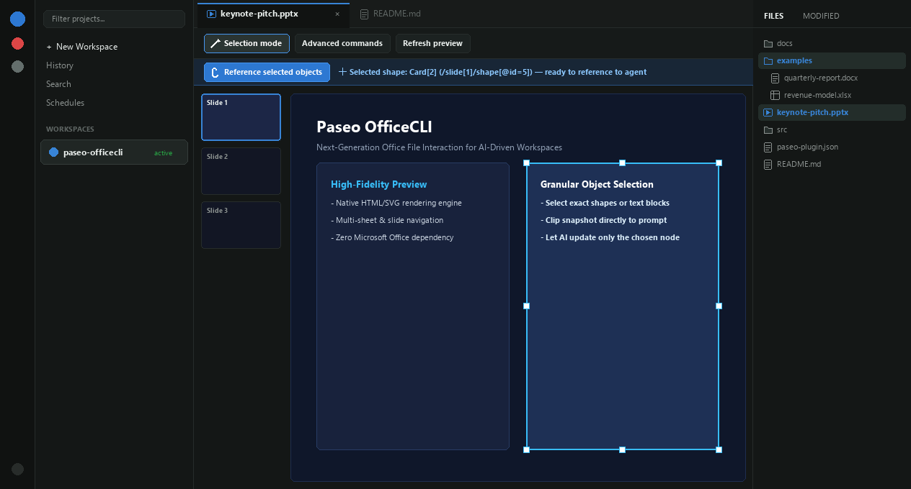
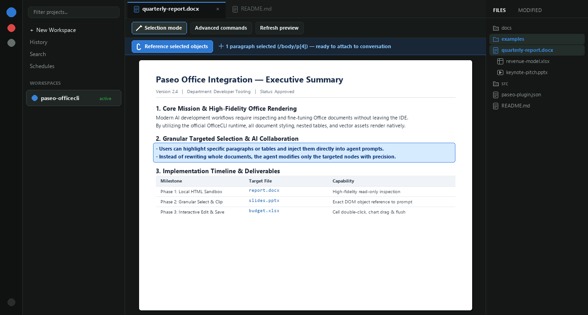
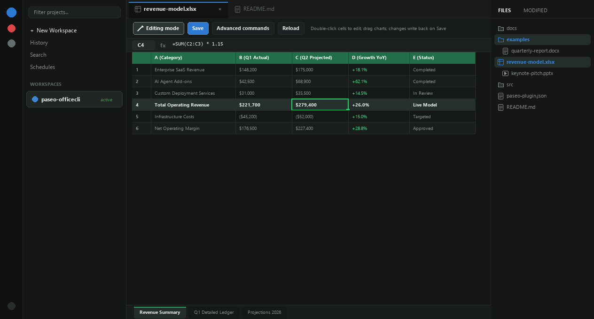

# Paseo OfficeCLI

在 [Paseo](https://github.com/getpaseo/paseo) 内直接查看和编辑 Office 文档，由官方 [OfficeCLI](https://github.com/iOfficeAI/OfficeCLI) 驱动。无需安装 Microsoft Office。

[English](README.md) · [简体中文](README.zh-CN.md)

[](https://github.com/plumegod/paseo-officecli/actions/workflows/check.yml)
[](LICENSE)

[功能](#features) · [安装](#installation) · [使用](#usage) · [安全](#safety) · [开发](#development)



> **主要解决的问题**：
> AI 工具通常无法直接查看或精确修改 Office 二进制格式文件，经常需要转换格式或全量重写。
> 结合 [Paseo](https://github.com/getpaseo/paseo) 与 [OfficeCLI](https://github.com/iOfficeAI/OfficeCLI)，可以在工作区内直接浏览文档、划选局部内容引用给 AI，或直接对表格进行交互编辑。

---

<a id="features"></a>
## 功能

| 核心功能 | 说明 | 支持格式 |
| :--- | :--- | :---: |
| **快速预览** | 在文件面板直接打开，无需安装庞大的微软 Office，文件变动自动重载。 | `.docx` `.xlsx` `.pptx` |
| **划区引用与局部修改** | 选中段落、表格或形状图元，将其路径与内容发给 AI 针对性修改，避免全量重写整篇文档。 | `.docx` `.pptx` |
| **Excel 实时编辑** | 双击单元格直接修改文本与数值，可拖动图表，保存即刻写回原文件。 | `.xlsx` |
| **CLI 控制台** | 传入 JSON 参数数组运行官方命令，直接查询或批量更新文档结构，提供实时输出与中止控制。 | `.docx` `.xlsx` `.pptx` |

|  |  |
| :---: | :---: |

> Word 和 PowerPoint 页面提供预览与选区功能，**不支持原位文字排版输入**。文本修改可使用高级命令、AI agent 或外部编辑器。

---

<a id="requirements"></a>
## 环境要求

| 组件 | 版本要求 | 说明 |
| :--- | :--- | :--- |
| **Paseo** | **0.16.0-beta.1 或更新版本** | 启用插件；daemon 所在机器须有 Node.js 和 npm，以获取插件包 |
| **OfficeCLI** | **1.0.160 或更新版本** | 官方稳定版，安装在 daemon 所在机器 |
| **客户端** | 桌面端或现代浏览器 | 不支持原生移动端预览 |

---

<a id="installation"></a>
## 安装

1. 确认已在运行 Paseo daemon 的机器上安装官方 OfficeCLI（详见 [OfficeCLI 官方安装说明](https://github.com/iOfficeAI/OfficeCLI#installation)）：

   ```sh
   officecli --version
   ```

2. 在 **Paseo 设置 → 插件** 中开启插件。在**插件来源**中粘贴 `npm:paseo-officecli`，点击**安装插件**。也可在 daemon 所在机器上执行一条安装命令：

   ```sh
   paseo plugin add npm:paseo-officecli
   ```

   这里使用 Paseo 官方的 [npm 插件来源](https://paseo.sh/docs/plugins/reference#npm-installation-and-publishing)。插件包的下载、编译与生命周期均由 Paseo 管理，无需拉取源码、手动安装项目依赖或单独构建。

3. 确认插件状态为 `running`：

   ```sh
   paseo plugin ls
   ```

   安装失败时，查看 `paseo plugin logs paseo-officecli`。

在文件树中点击任意 `.docx`、`.xlsx` 或 `.pptx` 文件，选择 **OfficeCLI** 即可打开。

更新插件：

```sh
paseo plugin update paseo-officecli
```

自定义路径说明见[程序查找与升级说明](docs/USAGE.md#officecli)（英文）。

---

<a id="usage"></a>
## 使用

### 模式说明与交互操作

| 格式 | 模式 | 操作方式 |
| :--- | :---: | :--- |
| **Word / PowerPoint** | **选择模式** | 划选文字或形状 → 点击**引用选中区域**为 AI 喂入上下文 |
| **Excel** | **编辑模式** | 双击单元格直接修改 → 拖拽图表 → 点击**保存**写入磁盘 |

### 高级命令
在工具栏选择**高级命令**，可直接向 OfficeCLI 传入 JSON 参数数组：

```json
["set", "draft.docx", "/body/p[1]", "--prop", "text=Updated from Paseo"]
```

查看命令帮助：

```json
["help"]
```

批处理与服务生命周期说明见[使用指南](docs/USAGE.md)（英文）。仓库内提供[样例文件](examples/)。

---

<a id="language"></a>
## 界面语言

在 **Paseo 设置 → 插件 → paseo-officecli → OfficeCLI → 语言** 中设置。可选择**跟随 Paseo**，也可选择 English、简体中文、繁體中文或日本語。仅保存在当前客户端。

---

<a id="safety"></a>
## 安全与限制

- **本地运算**：文档在本地渲染，不向第三方云服务上传私有文件。
- **沙箱隔离**：HTML 预览在受限 iframe 中运行，拦截外部未经授权的网络请求。
- **工作区边界**：文档操作均在当前工作区路径内进行校验。
- 更多说明见[使用指南](docs/USAGE.md)（英文）。已知问题见 [GitHub Issues](https://github.com/plumegod/paseo-officecli/issues) 与[已知问题列表](https://github.com/plumegod/paseo-officecli/issues/1)。

---

<a id="development"></a>
## 开发

需要 **Node.js 22.18 或更新版本**：

```sh
npm ci
npm run typecheck
npm test
npm run test:regression
npm run test:integration
```

本地安装测试：

```sh
paseo plugin install .
paseo plugin reload paseo-officecli
```

参与贡献请查阅 [AGENTS.md](AGENTS.md) 与[运行时国际化规范](docs/I18N.md)（英文）。

---

<a id="license"></a>
## 许可证

[MIT](LICENSE)。本项目为独立开源插件，非 Paseo 或 iOfficeAI 官方产品。OfficeCLI 许可详见[上游仓库](https://github.com/iOfficeAI/OfficeCLI)。
